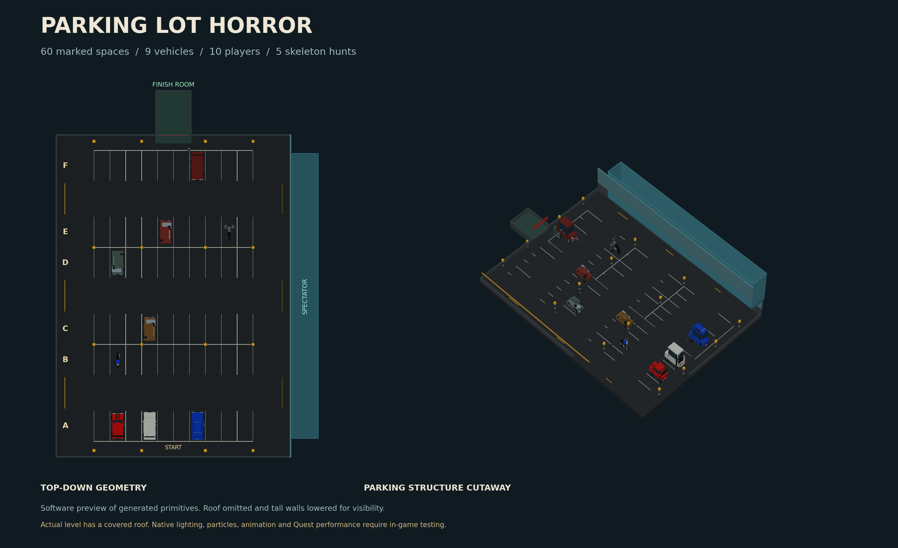

# Ernesto’s GRAB VR Levels

GRAB VR levels, reusable assets, native gameplay code, and per-game development notes.

## Office After Hours

An experimental cooperative office horror level designed for **10 players**: ten offices, three protective gems, individual hiding spaces, timed monster hunts, and a key-gated escape.


- [Download the native .level file](office-after-hours/dist/office-after-hours.level?raw=true)
- [Game README and loading instructions](office-after-hours/README.md)
- [Requirements and design decisions](office-after-hours/LEVEL-MEMORY.md)
- [Quest play-test checklist](office-after-hours/docs/QUEST-PLAYTEST.md)

**Status:** Thirty-five local gameplay and native-contract checks pass. Ernesto has tested earlier builds on Quest. Revision 4 needs headset verification of fog clearing, drawer seating, fumes and safe hiding.

Latest build: **Hunt polish 4** explicitly clears fog after hunts, adds monster fumes, seats unclaimed gems in moving trays, makes active hiding fully safe, and increases pursuit speed to 3.4 m/s. Replace the previous level file and reload before retesting.

## Parking Lot Horror

A separate ten-player survival scene: sixty covered parking spaces, nine vehicles, three physical immunity gems, two sliding-minivan hiding spots and a detailed skeleton. Five 60-second hunts, temporary fog, a key-gated finish room and enclosed spectator gallery. Revision 2 adds free-direction ground pursuit around vehicles, moving door windows and a continuous exit room with the native finish block.



- [Download the native .level file](parking-lot-horror/dist/parking-lot-horror.level?raw=true)
- [Game README and loading instructions](parking-lot-horror/README.md)
- [Requirements and design decisions](parking-lot-horror/LEVEL-MEMORY.md)
- [Vehicle and skeleton preview](parking-lot-horror/docs/vehicles-and-monster-preview.png)
- [Validation and Quest checklist](parking-lot-horror/docs/VALIDATION.md)

**Status:** local native bytecode/format checks and software previews pass; Quest/multiplayer testing pending. Editor rendering was unavailable because the browser could not create a WebGL context.

## Project organization

Start new games with the [reusable element catalog and ChatGPT entrypoint](docs/reuse/README.md): component specifications, native/state contracts, and a composition workflow with a game-memory template. These document existing generator patterns; they are not an extracted prefab/runtime library.

Each new game gets its own folder and `LEVEL-MEMORY.md` documenting requirements, decisions, implementation details, and outstanding validation.

To build and test Office After Hours:

```sh
git clone https://github.com/emaldonadot/ernesto-grabvr-levels.git
cd ernesto-grabvr-levels/office-after-hours
python -m pip install -r requirements.txt
python src/build.py
python -m unittest discover -s tests -v
```

See the included upstream license for the third-party GRAB format schema.

## The Grave Yard

A new fenced graveyard horror project with 16 graves, climbable trees, a decaying zombie, five hunts and a golden-skull gate puzzle. **Design committed; native .level and Quest validation pending.**

- [Game README](the-grave-yard/README.md)
- [Requirements and workstream handoffs](the-grave-yard/LEVEL-MEMORY.md)
- [Scene specification JSON (not native level JSON)](the-grave-yard/scene-spec.json)
