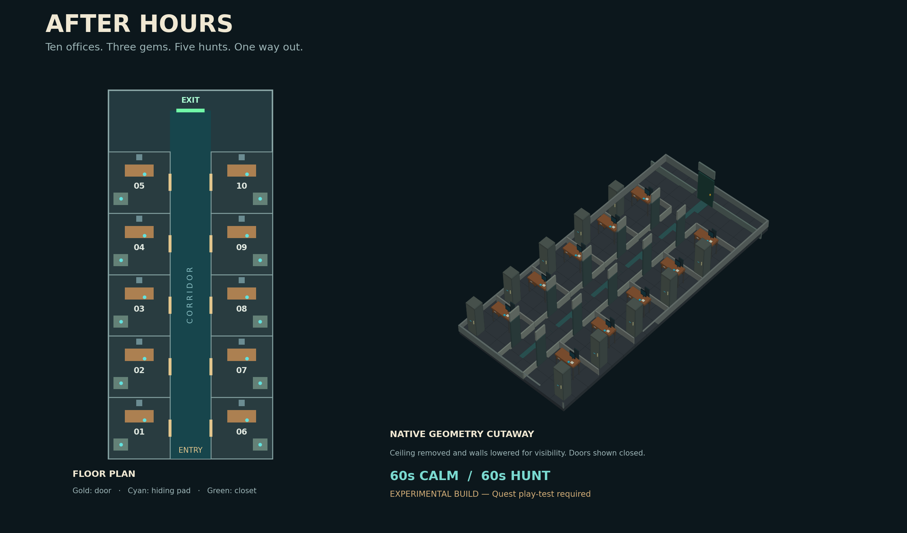

# Ernesto’s GRAB VR Levels

GRAB VR levels, reusable assets, native gameplay code, and per-game development notes.

## Office After Hours

An experimental cooperative office horror level designed for **10 players**: ten offices, three protective gems, individual hiding spaces, timed monster hunts, and a key-gated escape.



- [Download the native .level file](office-after-hours/dist/office-after-hours.level?raw=true)
- [Game README and loading instructions](office-after-hours/README.md)
- [Requirements and design decisions](office-after-hours/LEVEL-MEMORY.md)
- [Quest play-test checklist](office-after-hours/docs/QUEST-PLAYTEST.md)

**Status:** Eleven local gameplay logic tests pass. Native GRAB / Quest multiplayer play-testing is still pending. Monster visibility and spectator behavior remain experimental.

## Project organization

Each new game gets its own folder and `LEVEL-MEMORY.md` documenting requirements, decisions, implementation details, and outstanding validation.

To build and test Office After Hours:

```sh
git clone https://github.com/emaldonadot/ernesto-grabvr-levels.git
cd ernesto-grabvr-levels/office-after-hours
python -m pip install -r requirements.txt
python src/build.py
python -m unittest discover -s tests -v
```

See the included upstream license for the third-party GRAB format schema.
